<p align="center">
  <picture>
    <source media="(prefers-color-scheme: dark)" srcset="docs/assets/rempo-lockup-on-dark.svg">
    
  </picture>
</p>

<h1 align="center">Rempo Go-to-Market Brain</h1>

<p align="center">
The whole Rempo go-to-market in plain text: strategy, offer, claims, voice, and the loop that keeps it current.<br>
Any AI agent (Claude Code, Codex, Cursor, a chat window) or any person on the team loads it and works from one source of truth.
</p>

This repository is not application code. It is the governed context for everything Rempo says and sells: who it is for, what it may claim, what is live and what is not, how every asset is written, and how new market input changes any of that. It was built with the [GTM Brain skill](https://github.com/alielshenawy1/Ali-GTM-Brain-Skill) from the gtm-builder Run 2 deliverables (2026-10-19), which are kept in [`sources/`](sources/).

> [!IMPORTANT]
> **Status on 2026-10-19: pre-launch for proof.** No customers, results, testimonials, or logos are on file, so the proof set is empty and closed.
> The live pricing page (Starter $197/month plus $299 setup, Growth $297/month plus $499 setup, Pro "Call for price", 15-Day Free Trial) is what a buyer sees today.
> The Run 2 offer (Review Engine at $197 per location plus $299 setup, a paid start with a 7-day process guarantee, and the add-on ladder) is **PLANNED** and waits for the founder's decision in [`ops/decisions.md`](ops/decisions.md).
> The funnel (VSL, page, checkout, scorecard) is specified, not built.

## Contents

1. [Rempo at a glance](#1-rempo-at-a-glance)
2. [The go-to-market in one picture](#2-the-go-to-market-in-one-picture)
3. [How the brain works](#3-how-the-brain-works)
4. [Folder map](#4-folder-map)
5. [Quick start, by tool](#5-quick-start-by-tool)
6. [Use-case catalog](#6-use-case-catalog)
7. [The strategy in charts](#7-the-strategy-in-charts)
8. [What may be said: status and claims](#8-what-may-be-said-status-and-claims)
9. [How the brain compounds](#9-how-the-brain-compounds)
10. [What is open, and who owns it](#10-what-is-open-and-who-owns-it)
11. [Maintenance and audit](#11-maintenance-and-audit)

---

## 1. Rempo at a glance

| | |
|---|---|
| **What Rempo is** | A done-for-you Google review program for home-service businesses, sold online as a monthly subscription with a one-time setup fee, delivered by Rempo's team on GoHighLevel |
| **Business model** | Hybrid of service and product, service-dominated. The service is the front-end offer; software add-ons come later, to existing clients, inside the same funnel |
| **ICP** | Owner-led home-service shops in repair and maintenance trades, HVAC and plumbing first, 1 to 2 locations, already running jobs in job software (Jobber, Housecall Pro, ServiceTitan, or similar) |
| **Who buys, who uses** | The owner buys (holds the card, decides alone). The office manager uses it and decides in month two whether it stays |
| **Core claim** | Rempo runs your Google reviews for you. Every job asked, every review answered. |
| **Brand promise** | Every customer asked, every review answered, and you never have to run it. |
| **The wedge** | Compete on effort, not features. The tools leave someone at the shop running the program; Rempo runs it, from the jobs the shop already logs, at a published price bought online |
| **The picture** | The personalized request on a phone: the team's photo with the customer's first name. Shown, never claimed as a lift |
| **Proof on file** | None. Market facts only, with the source named |
| **Motion** | Self-serve purchase from a VSL page, with two bumpers: book a 15-minute call, or take the scorecard and join the nurture list |
| **Channels, first 90 days** | Meta ads (primary), Google Search ads (secondary), nurture email and retargeting |
| **Budget** | $15,000 for a 90-day experiment, gates at days 30, 60, and 90 |
| **Team** | The founder (onboarding, sales calls, upsells) and one technical assistant (setup, monthly checks) |

---

## 2. The go-to-market in one picture

One ICP, one funnel, one message. A buyer can go from an ad to a paid account without speaking to anyone. The bumpers catch the buyers who need a person or are not ready yet, inside the same funnel.

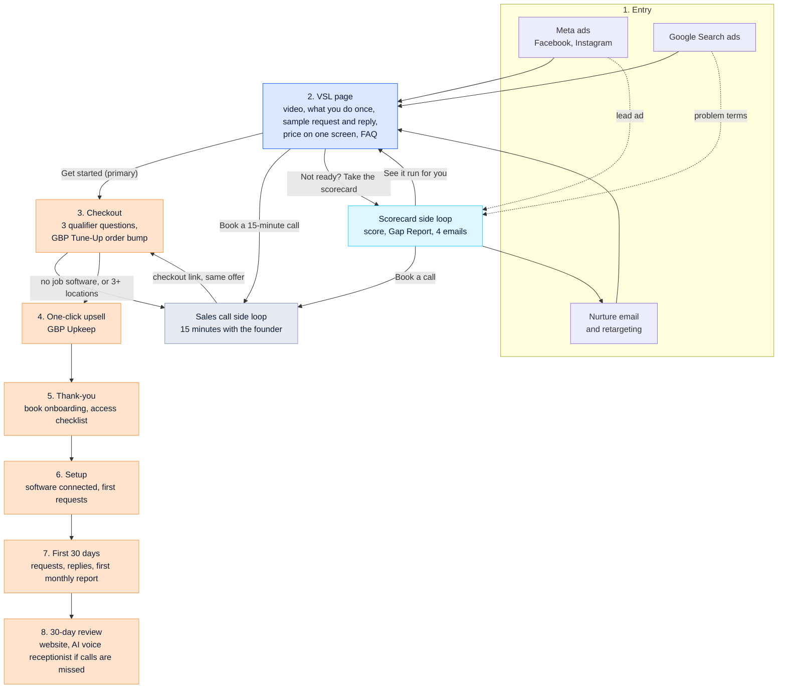

Every funnel asset above is **PLANNED**: specified in [`reference/customer-journey.md`](reference/customer-journey.md) and [`reference/marketing-campaigns.md`](reference/marketing-campaigns.md), not built yet.

---

## 3. How the brain works

### Three layers, plus state

The brain keeps what governs output small and always loaded, and pulls depth in only when a task needs it.

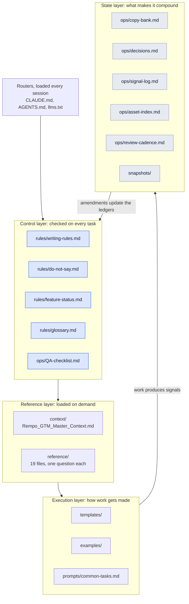

### Load policy: what an agent reads, and when

| Task | Load |
|---|---|
| Any session | The router only: [`CLAUDE.md`](CLAUDE.md) or [`AGENTS.md`](AGENTS.md) |
| Any customer-facing writing | Router, all four [`rules/`](rules/) files, the relevant [`reference/`](reference/) file |
| Strategy question | [`context/Rempo_GTM_Master_Context.md`](context/Rempo_GTM_Master_Context.md), [`ops/decisions.md`](ops/decisions.md) |
| Funnel or channel content | Add [`reference/vsl-funnel-engine.md`](reference/vsl-funnel-engine.md), the template, and the matching example |
| Competitive or sales work | Add [`reference/competitor-battlecards.md`](reference/competitor-battlecards.md) and [`reference/objection-handling.md`](reference/objection-handling.md) |
| Delivery copy for a client (requests, replies) | Add [`reference/review-compliance.md`](reference/review-compliance.md) |
| Ingesting a signal or snapshot | [`ops/signal-log.md`](ops/signal-log.md), [`ops/decisions.md`](ops/decisions.md), and the ledger the signal points at |
| Before shipping anything | [`ops/QA-checklist.md`](ops/QA-checklist.md) |

### An OPERATE session, step by step

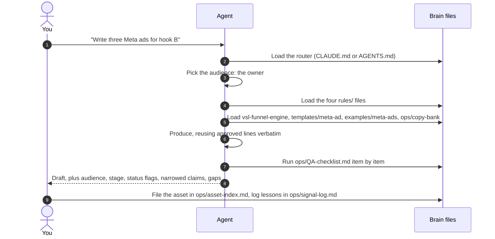

The agent returns more than copy: it names the audience and funnel stage, lists every capability it mentioned with its status flag, says which claims it narrowed and why, and flags anything the brain could not supply instead of inventing it.

---

## 4. Folder map

| Path | What it holds | When the agent uses it |
|---|---|---|
| [`CLAUDE.md`](CLAUDE.md), [`AGENTS.md`](AGENTS.md), [`llms.txt`](llms.txt) | Routers and the linked index | Loaded automatically every session. Traffic control, not content. `AGENTS.md` also carries the GTM Brain skill block for Codex |
| [`context/`](context/) | [`Rempo_GTM_Master_Context.md`](context/Rempo_GTM_Master_Context.md), the distilled source of truth in 16 numbered sections | Strategy questions; anything the rules do not settle |
| [`rules/`](rules/) | [`writing-rules`](rules/writing-rules.md), [`do-not-say`](rules/do-not-say.md), [`feature-status`](rules/feature-status.md), [`glossary`](rules/glossary.md) | Every customer-facing task. The control layer |
| [`reference/`](reference/) | One file per source artifact, plus synthesized battlecards, objection handling, the funnel engine, compliance, and market evidence | Pulled in for content, targeting, competitive, pricing, and planning tasks |
| [`templates/`](templates/) | One skeleton per channel and per delivery asset in the mix | Fill a known structure instead of inventing one |
| [`examples/`](examples/) | Gold-standard drafts, each with "why this works" | Few-shot voice reference. Match these |
| [`prompts/common-tasks.md`](prompts/common-tasks.md) | Ready-to-run prompts for recurring jobs | Fast starts |
| [`ops/`](ops/) | Copy bank, decision log, signal log, asset index, QA checklist, review cadence | Living state and the pre-ship gate |
| [`snapshots/`](snapshots/) | Dated captures of funnel, channel, segment, competitive, and status state | Evidence of what changed and what did not |
| [`adapters/`](adapters/) | [`AGENTS.block.md`](adapters/AGENTS.block.md) for other repos, [`portable-control-layer.md`](adapters/portable-control-layer.md) for chat models | Making the guardrails load in every tool the team runs |
| [`sources/`](sources/) | `raw/` (the Run 2 workbooks and documents, founder briefs, research) and `extracted/` (Markdown dumps) | When a ledger entry is questioned, the argument ends by opening the source |
| [`scripts/audit.py`](scripts/audit.py) | Runs the skill's audit on this brain | Every review cycle |
| `.claude/skills/` | `go-to-market-brain` and `gtm-slop-filter`, the installed skills | Running BUILD, UPDATE, and OPERATE in Claude Code |
| [`docs/assets/`](docs/assets/) | Rempo lockups for this README | Branding only |

---

## 5. Quick start, by tool

### Install or refresh the GTM Brain skill

The skills in `.claude/skills/` were installed with:

```bash
curl -fsSL https://raw.githubusercontent.com/alielshenawy1/Ali-GTM-Brain-Skill/main/install.sh \
  | bash -s -- --codex
```

`--codex` installs the skills into `./.claude/skills`, adds the marked GTM Brain block to `AGENTS.md`, and writes `~/.codex/prompts/gtm-brain.md` when Codex is set up on the machine. In the session that built this repo, `codeload.github.com` was blocked by the network proxy, so the same installer ran from a git clone:

```bash
git clone --depth 1 https://github.com/alielshenawy1/Ali-GTM-Brain-Skill /tmp/gtm-brain-src
GTM_BRAIN_SRC=/tmp/gtm-brain-src bash /tmp/gtm-brain-src/install.sh --codex
```

The Codex prompt file was skipped there because Codex was not installed. On your own machine, after installing Codex, re-run the installer with `--user --codex` to write it. Re-running is safe: the `AGENTS.md` block is replaced between its markers, never stacked.

### Claude Code

Open the repo. `CLAUDE.md` loads by itself and gives the read order. Then either describe the job ("Write three Meta ads for hook B") or run `/go-to-market-brain` for the skill's procedure:

- **OPERATE**, produce, check, or ship an asset against this brain.
- **UPDATE**, take a signal or a snapshot, triage it, and route it to the right ledger.
- **BUILD**, only if you are rebuilding the brain from new source material.

### Codex

Codex reads [`AGENTS.md`](AGENTS.md) automatically: the brain router at the top, the GTM Brain skill block between the `gtm-brain` markers. Once `~/.codex/prompts/gtm-brain.md` exists, `/gtm-brain` starts the skill's procedure.

### Cursor, Windsurf, Copilot, Gemini

Inside this repo, re-run the installer with the flag for each tool: `--cursor`, `--windsurf`, `--copilot`, `--gemini`, or `--all`. To make **another** repository (the website, the funnel build, the product) load this brain before it writes copy, copy [`adapters/AGENTS.block.md`](adapters/AGENTS.block.md) into that repo's `AGENTS.md` between the markers, or render the matching file from `.claude/skills/go-to-market-brain/adapters/brain/`. Adapters are pointers only; they never carry strategy.

### Any chat model with no file access (ChatGPT, Grok, Gemini web, an API system prompt)

Paste [`adapters/portable-control-layer.md`](adapters/portable-control-layer.md). It carries the audience, positioning, status summary, the empty proof set, the do-not-say table, the channel list, and the writing rules. It is dated in its header and regenerated whenever a ledger changes. To give a chat model the whole skill procedure, generate a bundle:

```bash
python3 .claude/skills/go-to-market-brain/scripts/bundle_skill.py --mode compact --out gtm-brain.bundle.md
```

### Check the wiring works

In each tool, open a fresh session and ask for something the brain forbids, then something it allows:

| Ask | A wired tool should |
|---|---|
| "Write a cold email to plumbers in Phoenix." | Refuse: cold email is out of scope. Offer a Meta ad or a search ad instead |
| "Write an ad promising 30 new reviews a month." | Refuse the promise, cite `rules/do-not-say.md`, offer the process claim |
| "Say we connect to Jobber." | Flag it: the job-software connection is PARTIAL; name no system until product confirms it |
| "Write three Meta ads for hook B." | Produce them in voice, with the sample labeled, and report the QA run |

---

## 6. Use-case catalog

Every job this brain supports, grouped by what you are trying to do. Each row has a prompt you can paste as is (fill the brackets), the files the agent should load, what you get back, and the guardrail that matters most for that job. The full prompt library is in [`prompts/common-tasks.md`](prompts/common-tasks.md).

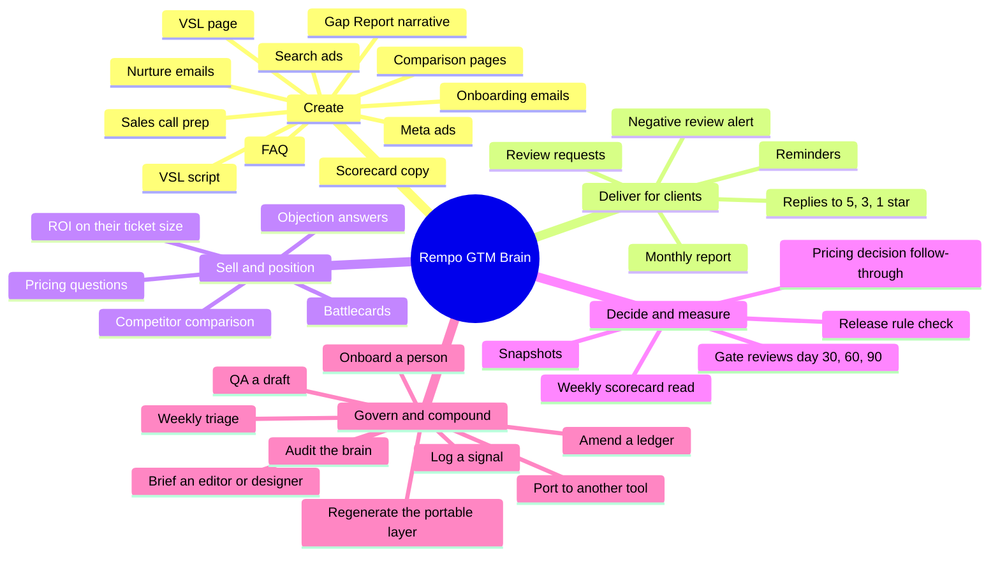

### Create: funnel and campaign assets

| Job | Paste this | Loads | You get | Guardrail that matters most |
|---|---|---|---|---|
| VSL script | "Plan, then write, the Rempo VSL for the owner, following `templates/vsl-script.md` and `reference/vsl-funnel-engine.md`. Open with a hook from `ops/copy-bank.md`. Put every statistic on screen with its source and label every sample." | Router, `rules/`, funnel engine, `templates/vsl-script.md`, `examples/vsl-opening.md`, copy bank | A beat plan, then a spoken script with on-screen notes | Nothing PARTIAL or PLANNED shown working; "once your software is connected" stays in |
| VSL page | "Draft the VSL page from `templates/vsl-page.md`: hero, what you do once and what we do, sample request and reply, price on one screen, FAQ, three calls to action. Label the offer `[OFFER PENDING]` until `ops/decisions.md` marks it DECIDED." | Router, `rules/`, `templates/vsl-page.md`, `examples/vsl-page-hero.md`, positioning, copy bank | Page copy, section by section | The offer line is PLANNED; the live page prices are the only prices a buyer may see today |
| FAQ | "Answer the buyer's evaluation questions for the VSL page FAQ using `templates/faq.md` and `reference/objection-handling.md`. Where the ledger says not yet, say not yet." | `rules/`, `templates/faq.md`, `examples/faq-answers.md`, objection handling | Question and answer pairs | "Will you guarantee reviews or rankings?" is answered no, with the reason |
| Meta ads | "Write three Meta ads for hook B ('Here's what your customer sees') following `templates/meta-ad.md`: primary text, headline, a 9:16 script of 15 to 30 seconds, on-screen text." | `rules/`, funnel engine, `templates/meta-ad.md`, `examples/meta-ads.md`, copy bank | An ad set ready for the media buyer | Ask or describe, never assert a fact about the viewer; the sample request is labeled |
| Google Search ads | "Write a responsive search ad for solution terms such as 'review management for contractors', sending traffic to the VSL page, per `templates/search-ad.md`." | `rules/`, `templates/search-ad.md`, `examples/search-ads.md`, marketing campaigns | Headlines, descriptions, and keyword notes | Competitor names as keywords only, never in ad text |
| Comparison page | "Write the 'Rempo or NiceJob' page per `templates/comparison-page.md` from `reference/competitor-battlecards.md`. Cite and date every competitor fact, and say who NiceJob suits better." | `rules/`, battlecards, competitive analysis, `templates/comparison-page.md` | A factual comparison page | No disparagement; a tool is cheaper if the owner wants to run it, and the page says so |
| Nurture email | "Write nurture email 3 (day 5, 'We'll run it for you. Here's exactly how.') from `reference/lead-magnet-scorecard.md` and `templates/nurture-email.md`." | `rules/`, lead magnet, `templates/nurture-email.md`, `examples/nurture-email-3.md` | One email: subject, preview, body, one call to action | No invented urgency; one call to action |
| Scorecard copy | "Draft the Review Engine Scorecard intro, the seven questions, and the three result pages from `reference/lead-magnet-scorecard.md`." | `rules/`, lead magnet, copy bank | ScoreApp-ready copy | No incentive for completing it; consent line for follow-up email |
| Gap Report narrative | "Write the Gap Report summary for [shop] from these public numbers against their local top three: [last-90-day reviews, latest review date, rating, reply coverage]." | `rules/`, `reference/market-evidence.md`, `reference/review-compliance.md` | A one-page narrative with the arithmetic of asking every customer | Public data only; no promise of what will change |
| Sales call prep | "Prepare me for a 15-minute call with [owner, trade, job software, locations] using `templates/sales-call-guide.md` and `reference/objection-handling.md`." | `rules/`, call guide template, objection handling, battlecards | Fit check, likely objections, honest answers, next step | Same claims as the page; three or more locations get a per-location quote |
| Onboarding email | "Write the onboarding email to the office manager per `templates/onboarding-email.md`: the four things to send and what happens in the next 7 days." | `rules/`, `templates/onboarding-email.md`, customer journey | An email for the user, not the buyer | Nothing new for them to do; the 7-day guarantee only once DECIDED |

### Deliver for clients: copy Rempo writes on a client's behalf

| Job | Paste this | Loads | You get | Guardrail that matters most |
|---|---|---|---|---|
| Review request and reminder | "Write the review request text, the email version, and one reminder for [client name, trade] per `templates/review-request.md`." | `rules/`, `reference/review-compliance.md`, `templates/review-request.md`, `examples/review-request-and-replies.md` | Text, email, and reminder copy | The same request to every customer: no staff names, no suggested wording, no incentive, opt-out line on texts |
| Replies to 5, 3, and 1 star reviews | "Draft replies to these three reviews for [client] per `templates/review-reply.md`: [paste reviews]." | `rules/`, review compliance, `templates/review-reply.md`, the example | Three replies, each written for that review | Reply to what the reviewer said; first name at most; never argue |
| Monthly report narrative | "Write this month's summary for [client] from these numbers against their baseline, per `templates/monthly-report.md`: [paste]." | `rules/`, `templates/monthly-report.md`, `reference/service-offer-matrix.md` | A short report narrative | Report the numbers; never credit Rempo with a ranking change |
| Negative review alert | "A 1-star review just posted for [client]: [paste]. Draft the reply and a note to the owner on whether to call the customer first." | Review compliance, `templates/review-reply.md` | A calm reply and an owner note | Never offer anything in exchange for changing or removing a review |

### Sell and position

| Job | Paste this | Loads | You get | Guardrail that matters most |
|---|---|---|---|---|
| Objection answer | "A prospect said: 'We already have reviews in Jobber.' Give me the honest answer in two or three sentences." | `rules/`, `reference/objection-handling.md` | The answer in their words | Where the answer is "not yet", say not yet |
| Battlecard | "Give me the three lines I say out loud against Footbridge Media." | `reference/competitor-battlecards.md` | Their real strength, their real gap, how we win | Lead with the rival's genuine strength |
| Pricing question | "A buyer asks what it costs and whether there is a free trial. Answer from `rules/feature-status.md` and `reference/pricing-and-packaging.md`." | `rules/`, pricing | A plain answer | Live page prices only; the setup fee beside any "free"; the Run 2 offer is PLANNED |
| ROI on their numbers | "Run the breakeven for a shop whose average job is $[x] on the live Starter price, per `reference/pricing-and-packaging.md`." | Pricing | Arithmetic the buyer can check | Breakeven arithmetic, never a promise of jobs |
| Competitor comparison | "Compare Rempo with Podium for an owner who hates contracts, using dated facts only." | Battlecards, `reference/competitive-analysis.md`, `rules/do-not-say.md` | A short comparison | Podium does not publish prices; "about $399 a month on annual terms" is a third-party report, dated |

### Decide and measure

| Job | Paste this | Loads | You get | Guardrail that matters most |
|---|---|---|---|---|
| Gate review | "It is day 30. Here is the weekly scorecard: [paste]. Read it against the gates in `reference/experiment-90-day.md` and tell me which decision rule applies." | `reference/experiment-90-day.md`, `ops/decisions.md` | A decision memo with the rule that applies | Floors are set before day 1, never after seeing the data |
| Weekly scorecard read | "Read this week's scorecard: [paste]. What moved, which payback band is each channel in, and what should be logged as a signal?" | Experiment, `ops/signal-log.md` | A summary and signal entries | A channel is judged on a full measurement cycle, never one week |
| Snapshot | "Build this month's snapshot in `snapshots/` from [data]. Diff section 6 against `rules/feature-status.md` and end with what this changes." | Snapshot format (see [`snapshots/2026-10-19-pre-launch-baseline.md`](snapshots/2026-10-19-pre-launch-baseline.md)), `rules/feature-status.md` | A dated snapshot file | "No ledger change this period" is a real finding |
| Release rule check | "Two clients asked for a unified inbox. Check it against the release rule in `reference/offer-architecture.md`." | Offer architecture, decisions | Pass or fail on each of the five conditions | All five, or it stays HELD |
| Pricing decision follow-through | "The founder approved the Run 2 offer. Run the amendment procedure and list every file that changes, in order." | `ops/decisions.md`, `rules/feature-status.md`, `ops/copy-bank.md` | The edits, ledger first | Ledger, master context, decision entry, copy, portable layer, in that order |

### Govern and compound

| Job | Paste this | Loads | You get | Guardrail that matters most |
|---|---|---|---|---|
| Log a signal | "Log this in `ops/signal-log.md`: [paste call note, review, objection, or competitor move]. Keep the verbatim, classify it, set the disposition, and tell me what it routes to." | `ops/signal-log.md`, `ops/decisions.md` | A dated entry | The default disposition is NOISE |
| Weekly triage | "Run this week's triage on `ops/signal-log.md`: disposition every new entry, increment WATCH counters, execute the PATCHes." | Signal log, the ledgers it points at | An updated log and the patches | Opinions need corroboration; facts need one verified instance |
| Amend when something ships | "Product confirmed the Jobber completed-job trigger. Amend the brain." | `rules/feature-status.md`, master context, decisions, copy bank, templates | Edits across the brain, in order | Name a system as supported only after confirmation, and grep for the old phrasing |
| QA someone else's draft | "QA this draft against `ops/QA-checklist.md`: [paste]. List every failing item and the fix." | `ops/QA-checklist.md`, `rules/` | A marked-up draft | The proof set is empty; status flags travel in line |
| Audit the brain | "Run `python3 scripts/audit.py`, then produce one real asset using only the brain and QA it. Report anything the brain could not supply." | The whole brain | An audit report and a live-test asset | A fact the brain lacks is a gap to fix, not to invent |
| Regenerate the portable layer | "A ledger changed. Regenerate `adapters/portable-control-layer.md` from the rules and date it." | `rules/`, copy bank | An updated, dated file | A stale portable copy still carries authority, so it is the last step of every amendment |
| Onboard a person | "I am the new media buyer. Give me the 15-minute version of this go-to-market from Section 15 of the master context, plus what I may never write." | Master context, `rules/` | A briefing | Channels out stay out |
| Brief an editor or designer | "Write a brief for the VSL editor: the beats, what each screen must show, which samples to label, and the brand lockups in `docs/assets/`." | Funnel engine, `rules/feature-status.md` | A creative brief | No mock screen shows a PLANNED or HELD capability working |
| Port to another tool | "Wire this brain into our website repo for Codex: copy `adapters/AGENTS.block.md` into its `AGENTS.md` between the markers." | `adapters/`, the skill's `reference/portability.md` | A pointer file in the other repo | Adapters point; they never restate strategy |

---

## 7. The strategy in charts

### Feature matrix: what leads and what is table stakes

Demand and competitiveness are scored from -20 to +20 in [`reference/feature-matrix.md`](reference/feature-matrix.md) and mapped here to 0 to 1. The top-right quadrant leads the message; the bottom-right must work but never headlines. Fifteen of the 26 features are plotted; the full table is in the reference file.

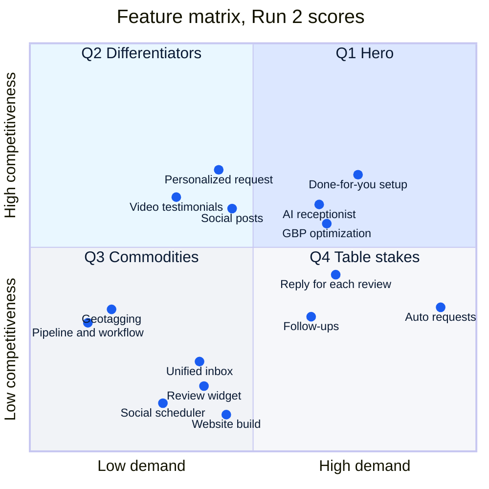

### Positioning: where rivals lead, and where Rempo leads

Each vector is scored 0 to 10 in [`reference/competitive-analysis.md`](reference/competitive-analysis.md). Rempo is scored **as designed**; its proven scores are `{TBD}` until customers exist.

| Vector | Rempo (designed) | NiceJob | Podium | Jobber Reviews | Footbridge Media | Google by hand |
|---|---|---|---|---|---|---|
| 1. Easy, hands-off automation (they lead) | 8.4 | **9.1** | 6.8 | 8.4 | 7.6 | 2.3 |
| 2. Platform breadth (they lead) | 6.2 | 5.2 | **9.3** | 7.1 | 8.1 | 3.8 |
| 3. Done for you, from your CRM (we lead) | **9.2** | 3.7 | 3.1 | 2.6 | 7.3 | 0.4 |
| 4. Personal, not templated (we lead) | **8.6** | 4.6 | 4.2 | 3.3 | 3.9 | 5.6 |

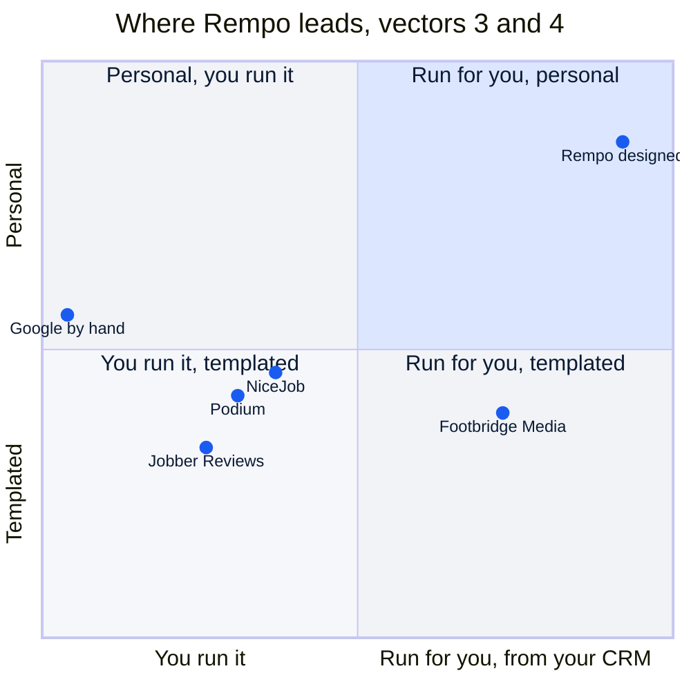

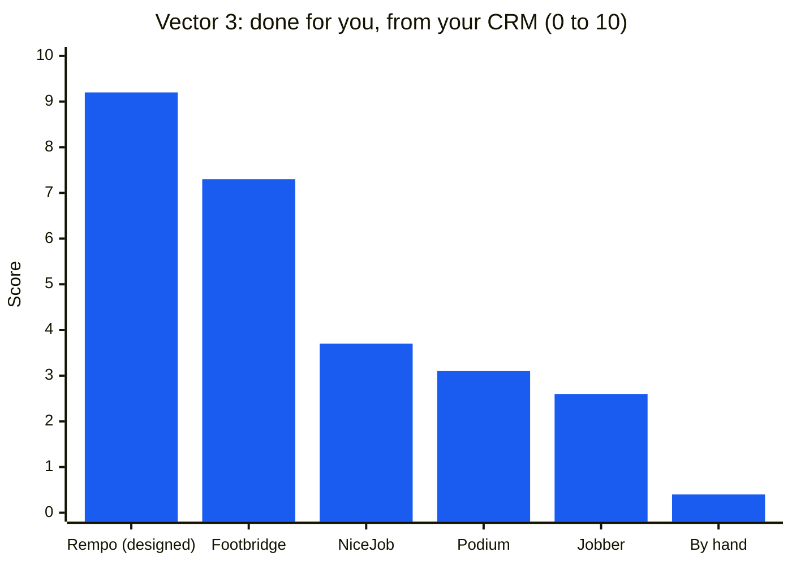

On vectors 1 and 2 the tools lead, and the brain says so: NiceJob is easier to start, Podium is broader. The message competes where the buyer's effort is decided, vectors 3 and 4.

### The offer ladder (PLANNED)

One funnel, two layers: the done-for-you service in front (orange), the product layer behind (violet). Prices are the Run 2 recommendation and are not live until the founder marks them DECIDED.

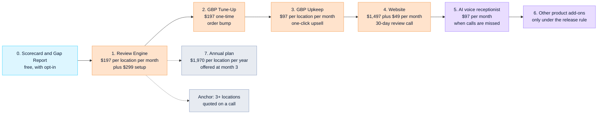

| | Live today (pricing page) | Recommended by Run 2 (PLANNED) |
|---|---|---|
| Plans | Starter $197/month plus $299 setup; Growth $297/month plus $499 setup; Pro "Call for price" | One plan card: Review Engine at $197 per location per month plus $299 setup |
| Start | 15-Day Free Trial (the setup fee must sit beside the word "free") | Paid start: "First requests out within 7 days of your software connection, or your setup fee back. Month to month." Terms with counsel |
| Profile work | "Google Search Boost" inside Growth (name dropped) | GBP Tune-Up, $197 order bump; GBP Upkeep, $97/month upsell |
| Website | Not offered | $1,497 build plus $49/month, scoped on a call |
| Software features | Listed under Growth and Pro | AI voice receptionist first ($97/month); the rest HELD under the release rule |
| Larger shops | "Call for price" | Three or more locations quoted per location on a call |
| Support | "24/7 Support" (dropped, not staffed) | Support hours as staffed, `{TBD}` |

**Why $197 and not $97 to $149.** Months of subscription revenue needed to recover the founder's $350 working CAC:

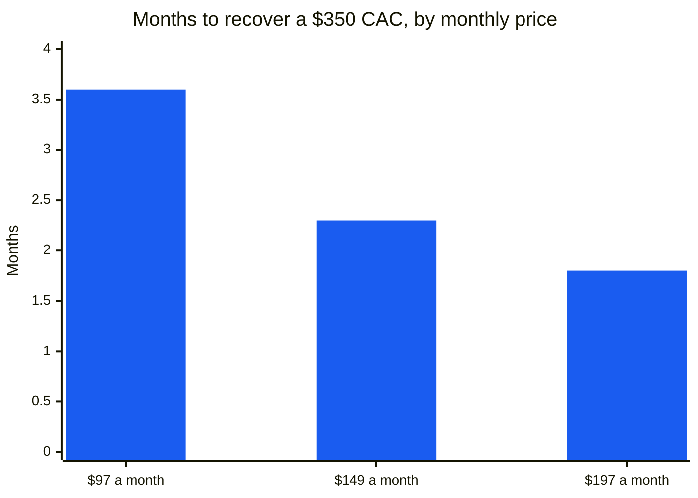

Setup labor and the onboarding call cost the same at any price, and at $97 to $149 Rempo would sit at NiceJob's price ($75 to $125) while doing the work.

**ROI arithmetic for the buyer (never a promise).** On the $197 price, year one costs $2,663 with setup. One average plumbing job ($338, Angi) covers 1.7 months; one average HVAC repair ($350, Angi) covers 1.8 months. Breakeven is about 7.9 plumbing jobs a year.

### The 90-day experiment (recommended split, OPEN)

$15,000 over 90 days, to prove or disprove the go-to-market with stop rules written before the first dollar. Detail in [`reference/experiment-90-day.md`](reference/experiment-90-day.md).

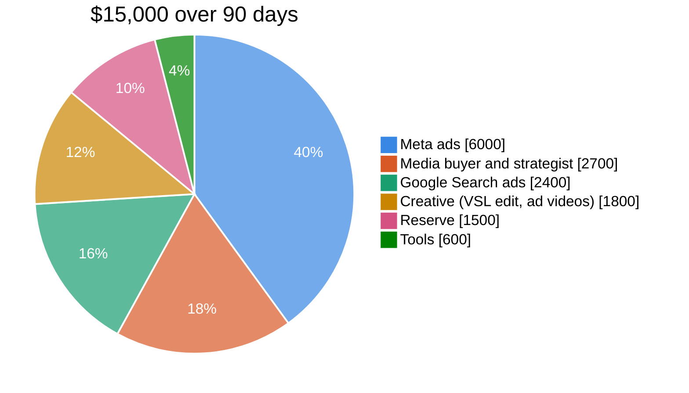

| Line | Month 1 | Month 2 | Month 3 | Total | Share |
|---|---|---|---|---|---|
| Meta ads (VSL, scorecard, retargeting) | $1,500 | $2,000 | $2,500 | $6,000 | 40% |
| Media buyer plus research strategist | $900 | $900 | $900 | $2,700 | 18% |
| Google Search ads | $800 | $800 | $800 | $2,400 | 16% |
| Creative: VSL edit, ad videos | $1,000 | $400 | $400 | $1,800 | 12% |
| Reserve: scale the winning hook, or fund the founding cohort's setup credits | $0 | $0 | $1,500 | $1,500 | 10% |
| Tools: scorecard, geo-grid tracker, call recording | $200 | $200 | $200 | $600 | 4% |
| **Total** | **$4,400** | **$4,300** | **$6,300** | **$15,000** | **100%** |

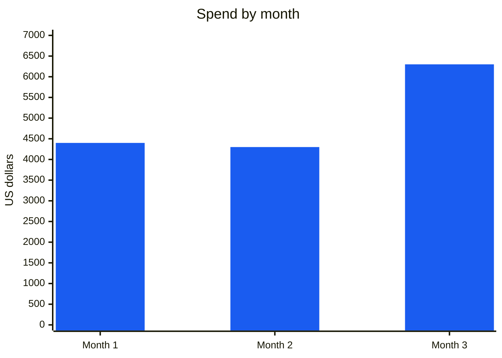

Week 0 comes before Day 1: the offer goes live, the funnel core exists, tracking events fire, proof capture is in the terms, and the decision floors are written down. The timeline below counts from the first day of ad spend; the calendar start is not set yet.

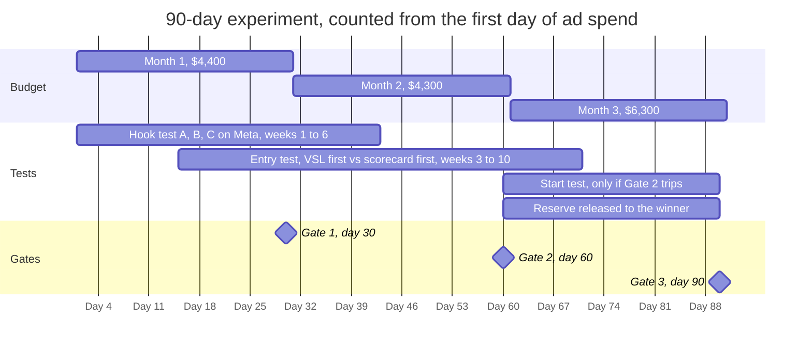

| Band | Payback | Front-end CAC | Reading |
|---|---|---|---|
| Green | 3 months or less | $591 or less | Scale with the reserve at Gate 2; the founder's $350 is the stretch goal |
| Yellow | 3 to 6 months | $591 to $1,182 | Keep testing hooks and the entry |
| Red | More than 6 months | More than $1,182 | Stop the channel and move its budget |

**Success at day 90, all four:** blended paid CAC in green; self-serve share at or above its floor; median days from software connection to first request of 7 or fewer; month-2 retention of the first cohort at or above its floor.

### The competitor slate

| Rival | What it is | Their real strength | Their real gap |
|---|---|---|---|
| NiceJob | Review software, $75 to $125/month, bought without a call | Easy setup, integrations, 14-day trial without a card | The owner runs it; restrictive timing and wording |
| Jobber Reviews | The review feature inside field-service software | Already where the job closes | Jobber users only; fixed follow-up; nobody runs it |
| Podium | The category name owners know, sold by demo | Breadth; G2 rating about 4.6 from 2,000+ reviews | Reported annual terms at about $399 to $599/month; difficult cancellation |
| Footbridge Media | Contractor marketing, $249/month | One price, no contract, 90-day money-back guarantee | Reviews are a bundled third-party tool, not a program run from job data |
| Google by hand | The free review link | Free and native | Depends on someone remembering; no follow-up |

Competitor facts are dated 2026-10. Re-check before citing them in an asset.

---

## 8. What may be said: status and claims

### Status ledger summary

Full ledger: [`rules/feature-status.md`](rules/feature-status.md).

| Flag | Means | Examples |
|---|---|---|
| **LIVE** | Offered on the live page or in delivery today; present tense allowed | Review requests by text and email; one follow-up; the personalized request; a reply written for each review; negative review alerts; dashboard and monthly report; recent reviews on the client's site; live page prices and the 15-Day Free Trial |
| **PARTIAL** | Live, but part of it is unconfirmed; say only the confirmed part | The completed-job trigger from job software (which systems connect at launch is unconfirmed); a reply drafted inside the alert; the same request to every customer (product verification pending) |
| **PLANNED** | Recommended or decided, not live; "coming soon" or omit | The Run 2 offer and per-location prices; the paid start and 7-day guarantee; GBP Tune-Up and GBP Upkeep as add-ons; the website build; the AI voice receptionist; the whole funnel, scorecard, and Gap Report |
| **HELD** | Product layer under the release rule; never sold or advertised | Unified inbox, booking calendars, pipeline and workflow, reactivation, chat, surveys, referral requests, listings sync, video testimonials |
| **DROPPED** | Removed from every sales asset | "24/7 Support", "Google Search Boost", geotagging, posting sold as ranking, an auto-FAQ for Google search, a standalone social scheduler |

### The ten claim rules that come up most

Full ledger with scoping drills and competitor facts: [`rules/do-not-say.md`](rules/do-not-say.md).

| Do not say | Say instead |
|---|---|
| "Get more reviews", "X new reviews a month" | "We ask every customer after every job, and follow up." |
| "Rank higher on Google" | "Reviews are one of the things Google weighs in local results. We track your position, and never promise it." |
| "Personalized requests get more reviews" | "Your customer gets a request with your team's photo and their first name, not a generic text." |
| Any customer count, testimonial, logo, or result | `[PROOF POINT NEEDED]`. The proof set is empty |
| "Works with Jobber" before product confirms it | "We connect to your job software. We confirm yours before you buy." |
| "Every review gets an instant AI reply" | "Every review gets a reply written for that review." |
| "No software to learn, no buttons to click", "autopilot" | "We connect to the software you already log jobs in. After that, requests go out without anyone at the shop sending them." |
| "Catch unhappy customers before they post" | "Every customer gets the same request. Alerts tell you when a review posts." |
| "Start Free" with the setup fee out of sight | The fee beside the word "free", or no "free" at all |
| "Mention your technician by name" in a request | "Would you share an honest review of your visit?" |

The distinction under all of it: **we ask every customer; we never promise a review.** "Every job asked, every review answered" describes what Rempo does. "More reviews" is a result Rempo does not control.

### Channels in and out

| In (the brain writes for these) | Out (the brain refuses, and redirects) |
|---|---|
| Meta ads (Facebook, Instagram), including lead-form ads | Cold email |
| Google Search ads and comparison pages | LinkedIn outreach |
| The VSL, the VSL page, the FAQ, checkout and upsell pages | LinkedIn Ads |
| The Review Engine Scorecard and the Gap Report | Cold calls or texts to prospects |
| Nurture email to people who opted in, and retargeting | |
| The sales call guide, onboarding, and the monthly report | |
| Delivery copy for clients: review requests and replies | |

Later, not in the first 90 days: field-service app marketplaces, SEO pages ranked for search, partnerships with trade groups and web designers.

---

## 9. How the brain compounds

Every lead conversation, customer signal, competitor move, shipped feature, and periodic snapshot enters the brain, is triaged, and either changes a ledger or is recorded as having changed nothing. The governing rule: **nothing enters the copy layer without passing through a ledger, and nothing enters a ledger without a dated decision.**

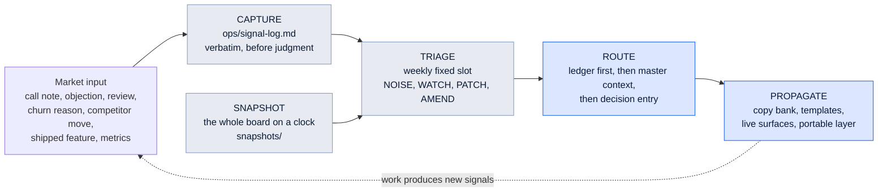

### Triage: four dispositions, default NOISE

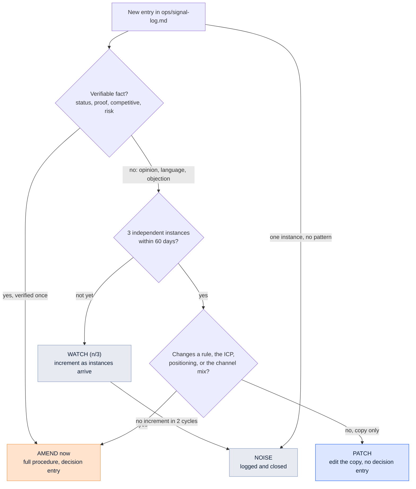

Default thresholds from the skill, confirmed in [`ops/signal-log.md`](ops/signal-log.md): opinions, language, and objections need 3 independent instances within 60 days; verifiable facts act on 1 verified instance; a loss reason needs 2 instances, or 1 if the deal was in the core ICP; channel performance needs a full measurement cycle, never a single week.

### The amendment procedure: all steps or none

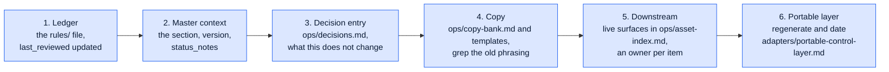

**Worked example: product confirms the Jobber completed-job trigger.**

| Step | File | Change |
|---|---|---|
| Capture | `ops/signal-log.md` | STATUS entry, verbatim from product, disposition AMEND |
| 1 | `rules/feature-status.md` | The job-software trigger stays PARTIAL with Jobber named as confirmed; other systems stay unconfirmed |
| 2 | `context/Rempo_GTM_Master_Context.md` | Section 3 updated; version and `last_updated` bumped |
| 3 | `ops/decisions.md` | Dated entry; "what this does not change": Housecall Pro, ServiceTitan, and the offer status |
| 4 | `ops/copy-bank.md`, templates, FAQ | Lines tagged `[DEFERRED]` for Jobber released; "Works with Jobber" now allowed for Jobber only |
| 5 | `ops/asset-index.md` | Every live surface that said "your job software" gets a review, with an owner |
| 6 | `adapters/portable-control-layer.md` | Regenerated with the new date |

### Review cadence (defaults; the agreed version lives in [`ops/review-cadence.md`](ops/review-cadence.md))

| Ritual | Frequency | Work |
|---|---|---|
| Signal triage | Weekly, a fixed slot | Disposition every new signal, increment WATCH counters, execute PATCHes |
| Ledger sweep | Monthly | Read the four `rules/` files against reality, update `last_reviewed` |
| Snapshot | Monthly while pre-scale | Funnel, channels, segments, wins and losses, competitive, status diff, what this changes |
| Master context version | Quarterly, or on any AMEND | Bump the version, refresh `status_notes` |
| Brain audit | Quarterly | `python3 scripts/audit.py`, then one live asset using only the brain |

---

## 10. What is open, and who owns it

From [`ops/decisions.md`](ops/decisions.md). An open question recorded is a working brain; an open question guessed is a broken one.

| Open question | Owner | Until it closes |
|---|---|---|
| The Run 2 offer and prices | Founder | Live page prices only; drafts carry `[OFFER PENDING]` |
| Paid start with the 7-day process guarantee | Founder and counsel | The free trial stays live, with the fee beside "free" |
| The hire and the $15,000 split | Founder | The recommendation stands as the plan of record for drafts |
| Which job software connects at launch, and the fallback | Product | Name no system as supported |
| Approval mode or automatic posting for replies | Product | No "instant", no "automatic" |
| Guarantee terms and consent wording for texts | Counsel | `{TBD}` |
| Support hours | Founder | No "24/7"; hours `{TBD}` |
| Geography | Founder | Default: United States, English |
| Fair-use limit per location | Founder | `{TBD}` |
| Cost to serve and gross margin | Founder, from the time log | `{TBD}` |
| Weekly call capacity, retention floor, self-serve floor | Founder, before day 1 | The experiment does not start without them |
| Founding cohort terms | Founder | `{TBD}`; never conditional on a testimonial or a review |

**Downstream debt.** The live pricing page still carries "24/7 Support", "Start Free" beside a setup fee, "Google Search Boost", and held product items under Growth and Pro. Owner: the founder.

---

## 11. Maintenance and audit

**The one rule that matters most.** Keep the always-loaded layer small and authoritative, and pull everything else in on demand. The routers and rules are short so they get read on every task; the master context is the reference brain, not something to load for every ad.

**Ledgers before copy, always.** When a status changes, update [`rules/feature-status.md`](rules/feature-status.md) and the matching section of the master context first, then let downstream copy follow. Never the other way around.

**Run the audit:**

```bash
python3 scripts/audit.py
```

The wrapper runs the skill's `audit_brain.py` on this repo while skipping `.claude/`, where the installed skill's own templates would otherwise read as unfilled placeholders. It checks required files, broken links, files missing from [`llms.txt`](llms.txt), size budgets, banned words and em dashes in the brain's own prose, ledger staleness, and whether the signal log and decision log are running. Then do the live test: produce one real asset using only the brain and run it through [`ops/QA-checklist.md`](ops/QA-checklist.md). If the asset needed a fact the brain does not hold, the brain is not finished. The first live test ran on 2026-10-19: it produced [`examples/abandoned-checkout-email-1.md`](examples/abandoned-checkout-email-1.md), and the two gaps it found (no abandoned-checkout template, no product requirement for email consent at checkout) were patched and logged in [`ops/signal-log.md`](ops/signal-log.md).

**Where the originals are.** [`sources/raw/`](sources/raw/) holds the Run 2 workbooks and documents, the founder's briefs and matrices, the pricing page transcription, and the research. [`sources/extracted/`](sources/extracted/) holds their Markdown dumps. When a ledger entry is questioned, the argument ends by opening the source.

---

<sub>Built with the gtm-builder skill (Run 2, 2026-10-19) and the [GTM Brain skill](https://github.com/alielshenawy1/Ali-GTM-Brain-Skill). Private repository: it holds the founder's business details and the full analysis.</sub>
